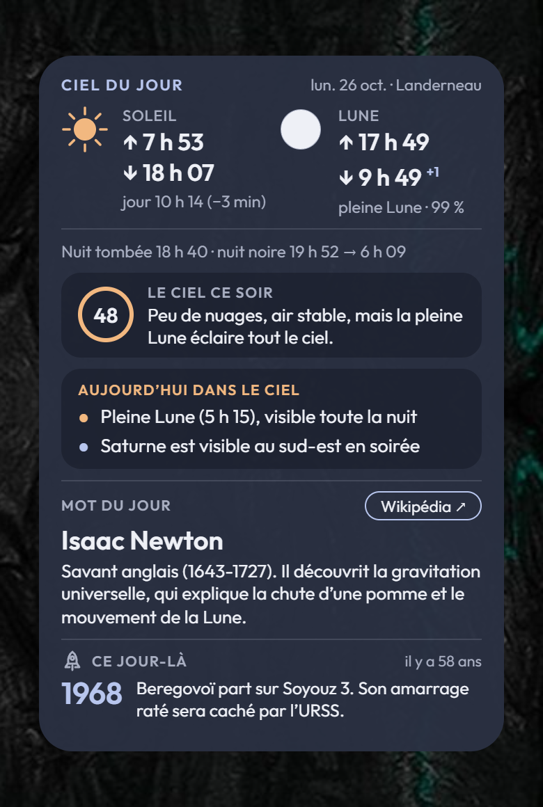
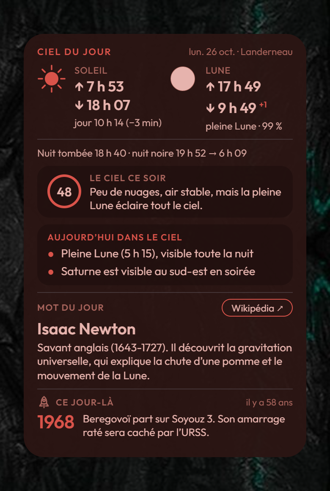

 


# Widget « Éphéméride astro »

> **Version 2.0** (octobre 2026) — tout-en-un, format 4×6

Un widget Android ([KWGT](https://play.google.com/store/apps/details?id=org.kustom.widget))
qui réunit, **pour la position du téléphone**, tout ce qu'il faut savoir sur le ciel du jour.
Il **passe en rouge** dès que le Soleil descend à −6° sous l'horizon, pour garder la vision de nuit.

| Section | Contenu |
|---|---|
| **Éphéméride** | Lever et coucher du Soleil (durée du jour, écart avec la veille), de la Lune (phase, illumination, **+1** si elle se couche le lendemain), nuit tombée (−6°) et nuit noire (−18°) |
| **Le ciel ce soir** | Note sur 100 (nuages, Lune, stabilité de l'air) dans un anneau vert, orange ou rouge, et une phrase : « Ciel dégagé de 22 h à 7 h, air stable, sans Lune gênante. » |
| **Aujourd'hui dans le ciel** | Étoiles filantes, équinoxes et solstices, phases de la Lune, rapprochements Lune-planète, planètes visibles |
| **Mot du jour** | Un mot du glossaire (290 mots) et sa définition, avec un bouton **Wikipédia ↗** facultatif |
| **Ce jour-là** | Un fait d'histoire de l'astronomie survenu à la même date (633 faits) |

Le mot du jour suit la même rotation que le widget « Mot astro du jour ». Les jours d'événement,
il ne répète pas la pleine Lune ou la pluie d'étoiles filantes, déjà annoncées plus haut.

---

## Installation

### 1. Sur le serveur

1. Copier le dossier `ephemeride` sur l'hébergement (PHP 7.4 ou plus, avec GD, FreeType et cURL).
2. Le dossier `cache/` doit pouvoir être créé et écrit par PHP (prévisions météo).
3. Ouvrir `https://votre-site/ephemeride/ephemeride-widget.php` : l'image doit s'afficher.

### 2. Dans KWGT

1. Autoriser KWGT à accéder à la position (réglages Android → Applications → KWGT → Autorisations).
2. Ajouter un widget KWGT **4×6**, puis un élément **Image**, largeur **334**, en haut à gauche.
3. Sur la ligne **Bitmap**, cocher la case « formule » et coller :

```
https://votre-site/ephemeride/ephemeride-widget.php?lat=$li(lat)$&lon=$li(lon)$&loc=$li(loc)$&v=$df(yyMMddHH)$$mu(floor, df(mm)/15)$
```

4. Ajuster l'**échelle** de la racine (onglet Calque) pour que l'image remplisse le widget
   (en 4×6, elle doit presque toucher les bords gauche et droit).

> Vérifier dans l'aperçu que la fin de l'adresse donne bien une date, par exemple `&v=261026183`.
> Si l'on voit `df(yyMMddHH)` en toutes lettres, il manque un `$` : le widget ne se mettrait jamais à jour.

### 3. Le bouton « Wikipédia ↗ » (facultatif, masqué par défaut)

Le bouton n'est pas dessiné par défaut. Pour l'afficher, retirer les `//` devant les deux lignes
`$d->pilule(…)` et `$d->texte('Wikipédia ↗', …)` dans `ephemeride-widget.php`, section « 4. Mot du jour ».
Une forme invisible posée dessus ouvre alors la page Wikipédia du mot du jour.

1. Dans l'éditeur du widget, rester sur la **racine** et toucher **+**, puis **Forme**.
2. Onglet **Forme** : type **Rectangle**, largeur **112**, hauteur **38**.
3. Onglet **Position** : ancrage **en haut à gauche**, décalage X **210**, décalage Y **324**.
4. Onglet **Peinture** : blanc, opacité **30 %** le temps de vérifier la position.
5. Onglet **Toucher** : **+**, Action **Ouvrir un lien**, et coller :
   `https://votre-site/ephemeride/wiki.php`
6. Enregistrer. Le rectangle doit recouvrir le bouton ; ajuster X et Y si besoin,
   puis remettre l'opacité à **1 %**.

La forme doit être **sous l'image dans la liste** de la racine. Le bouton est toujours
au même endroit, quelle que soit la longueur des textes.

> Ne jamais mettre d'action au toucher sur l'image elle-même : sur certains téléphones,
> l'appui long ne permet plus alors d'éditer le widget.

### 4. Sauvegarder

Une fois le widget en place : menu de l'éditeur → **Exporter le préréglage**. Le fichier `.kwgt`
va dans le dossier **Kustom/widgets** du téléphone, et se recharge depuis l'onglet **Exportés**.

---

## Passer de la version 1.1 (4×4) à la 2.0

L'adresse ne change pas : agrandir le widget en **4×6**, réajuster l'échelle de la racine,
et, si on le souhaite, afficher le bouton Wikipédia. L'ancienne version compacte reste disponible à l'adresse
`ephemeride-4x4.php` (mêmes paramètres), pour un widget 4×4.

---

## Réglages (`config.php`)

| Réglage | Rôle |
|---|---|
| `lieu`, `latitude`, `longitude` | Lieu par défaut, sans position du téléphone |
| `fuseau` | Fuseau horaire d'affichage (`Europe/Paris`) |
| `theme`, `rouge_soleil_sous` | `auto` (rouge sous −6°), `rouge` ou `normal` |
| `seuil_nuages`, `modele`, `seeing_7timer` | Météo du soir, comme le widget astro Alnitak |
| `debut` | Premier jour du cycle du mot du jour (le même que le widget « Mot astro du jour ») |

---

## Modifier les textes

- **Faits « Ce jour-là »** : `lib/donnees/cejour.php`, sous la forme
  `'10-26' => [[1968, 'm', 'Texte du fait.'], …]` (type `m` mission, `d` découverte,
  `p` personne, `c` ciel). Deux lignes au plus, environ 80 caractères.
- **Mots du jour** : `lib/donnees/glossaire.php` (le même fichier que le widget « Mot astro du jour »).

---

## Contenu du dossier

| Fichier | Rôle |
|---|---|
| `ephemeride-widget.php` | Image du widget tout-en-un (4×6) |
| `ephemeride-4x4.php` | Ancienne version compacte (4×4) |
| `wiki.php` | Redirection vers la page Wikipédia du mot du jour |
| `config.php` | Réglages |
| `lib/Ephemeride.php` | Levers, couchers, crépuscules, phases et phénomènes du jour |
| `lib/Nuit.php`, `lib/Ciel.php`, `lib/Lieu.php` | Météo du soir et note sur 100 (repris du widget Alnitak) |
| `lib/MotDuJour.php`, `lib/donnees/glossaire.php` | Mot du jour |
| `lib/CeJour.php`, `lib/donnees/cejour.php` | Faits « Ce jour-là » |
| `lib/Astro.php`, `lib/Planetes.php` | Positions du Soleil, de la Lune et des planètes |
| `lib/Pictos.php`, `lib/Dessin.php`, `lib/Theme.php`, `lib/garde.php` | Dessins, couleurs, protection |
| `fonts/` | Polices Outfit (OFL) et DejaVu Sans |

---

## Crédits

| Élément | Source | Licence |
|---|---|---|
| Nuages, courant-jet | [Open-Meteo](https://open-meteo.com) | CC BY 4.0 |
| Stabilité de l'air (seeing) | [7Timer!](https://www.7timer.info) | — |
| Soleil et Lune | J. Meeus, *Astronomical Algorithms* (2e éd.) | — |
| Planètes | E. M. Standish, [éléments orbitaux approchés (JPL)](https://ssd.jpl.nasa.gov/planets/approx_pos.html) | — |
| Glossaire et faits « Ce jour-là » | rédigés pour le club astro de La Martyre ; liens vers [Wikipédia](https://fr.wikipedia.org) | contenus Wikipédia CC BY-SA |
| Police | [Outfit](https://fonts.google.com/specimen/Outfit) | [SIL Open Font License](https://openfontlicense.org) |
| Symboles | [DejaVu Sans](https://dejavu-fonts.github.io) | licence libre (voir `fonts/DejaVu-LICENSE.txt`) |
